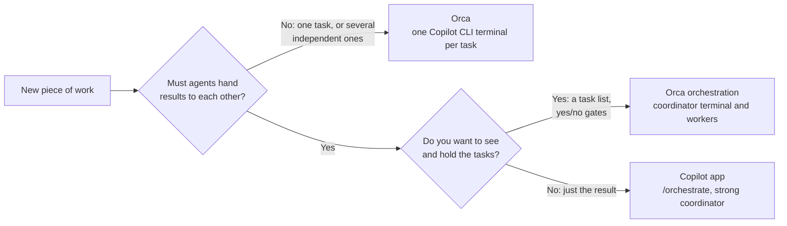
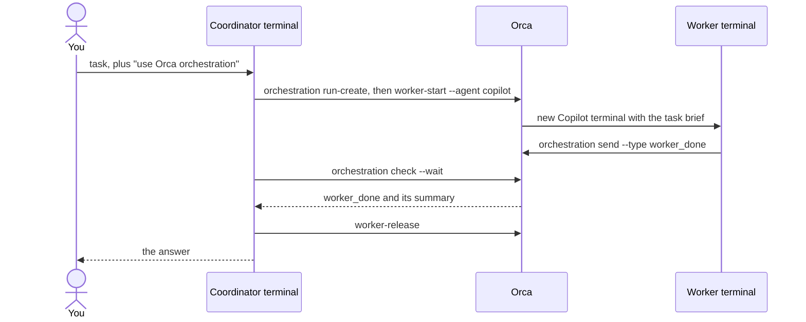
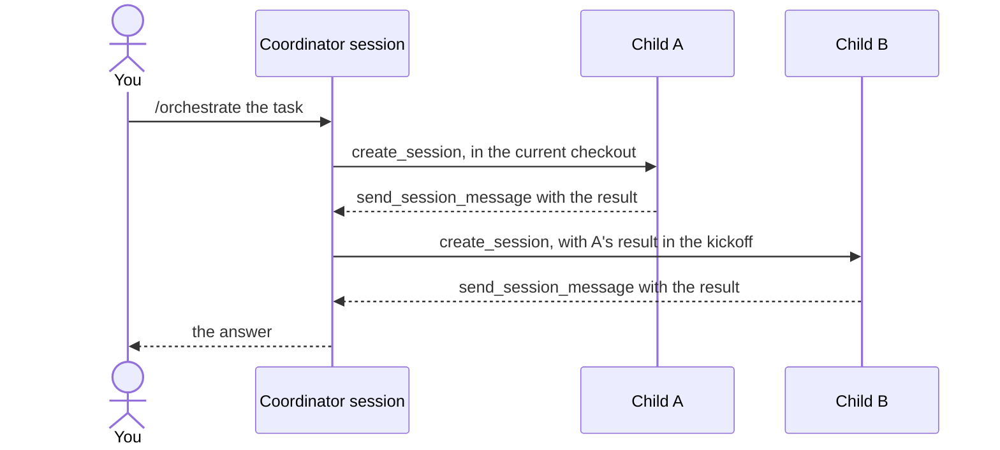
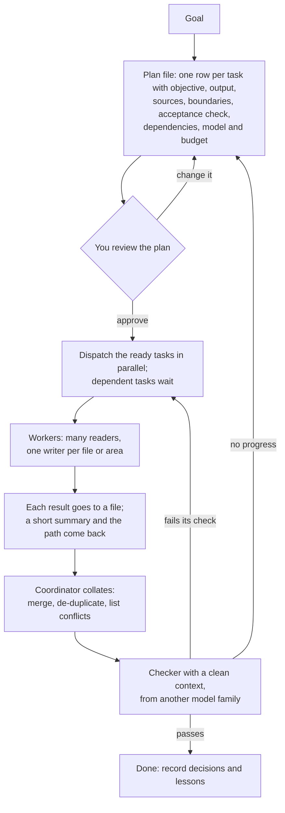

# Agent workbench: Orca and the GitHub Copilot app

Where I run and watch many coding-agent sessions, why these two tools, how to set them up and use them, and how to redo the choice. Checked on 2026-10-18 with Orca 1.4.229, GitHub Copilot app 1.1.30 and Copilot CLI 1.0.99.

How each statement is known: no mark means I ran it on 2026-10-18, once unless a count is given; **(read)** means from the tool's docs or source; **(inferred)** means reasoned, not observed; **OPEN** means not known.

## The choice

| Tool | Used for | Why |
| --- | --- | --- |
| [Orca](https://github.com/stablyai/orca) (MIT) | The daily workbench: many Copilot CLI sessions side by side, one terminal each. Also coordinated work where you want to see the tasks | Shows which session is waiting on you. A waiting request did not run when Orca quit, and the sessions survived the restart. Runs in any folder, including a repo's main checkout. Its coordinator ran a two-step job with tasks you can list and yes/no gates, but each coordination step is a shell command you approve. Also runs Cursor, Claude Code, Codex and others (read) |
| [GitHub Copilot app](https://github.com/github/app) | Coordinated work where you want only the result: `/orchestrate` with a strong coordinator model | Its agents pass work to each other with no approval per message. GitHub's own and included in the Copilot licence. It adds no hooks to the machine's other Copilot sessions. It keeps no task list |

For a project too big for one prompt, plan it first: see [Large work](#large-work-plan-assign-collate-check). Neither tool notices a session that has stopped making progress or has crashed; that part is a custom build.

### What the choice assumes

- **Copilot first.** Every session runs on GitHub Copilot: Copilot CLI in a terminal, or the app's own engine. Models come only through the Copilot sign-in, with no other provider keys. Cursor support is a bonus.
- **One knowledge repo with its product repos nested inside it.** An agent gets the repo's skills, `AGENTS.md` and instructions only when its working folder is that repo, so sessions run in its main checkout. A worktree that a tool makes has none of the nested repos, and it starts from the remote branch, not the local one.
- **macOS.** Both apps also ship for Windows and Linux; only macOS was tested.
- **Free:** open source, self-hosted, or already in the Copilot licence, with no vendor server holding session data.
- **A handful of sessions at once.** Up to three were run together; ten or more were not tested.

## How the choice was made

### Must-haves

A tool that fails one is out.

1. **Free:** open source, self-hosted, or in the Copilot licence. Paid SaaS and the free tier of a paid SaaS fail. A licence that bars commercial use fails, and a repo with no licence file is not open source: open the file rather than trusting GitHub's licence label.
2. **Models only through the Copilot sign-in:** Copilot CLI, the Copilot SDK, `copilot --acp`, VS Code's language-model API, or a third-party client GitHub officially supports. A tool that needs no model passes.
3. **No maker-hosted server holding session data.** GitHub itself is allowed.
4. **Works with where the code lives.** Copilot's cloud agent and the code review included in the licence need the repository on GitHub (read), and Copilot Memory likely does too (inferred). They don't count when the code is hosted elsewhere.
5. **Runs in a folder you choose**, or in a worktree whose location you choose.
6. **A third-party client that signs in with a work Copilot seat needs the employer's approval first.** Check the AI-tool policy, then ask the GitHub organisation admins, before signing in, because signing in with an unapproved client can itself break the policy. GitHub's docs name no policy switch for third-party local clients (read).

What a workbench must do on top: show at a glance whether a session is stuck (waiting on you, making no progress, or crashed), start sessions quickly, track tasks across agents, and keep sessions rooted in the knowledge repo. Nice to have: alerts, diff review, history and resume, automation, cost visibility, and safety controls.

### Project health

Health ranks the survivors; it does not cut on its own. I used the four [CHAOSS Starter Project Health](https://chaoss.community/kb/metrics-model-starter-project-health/) measures over the last 90 days, with my own pass marks:

- at least one release;
- a median first human response under 72 hours;
- a pull-request closure ratio of 0.7 or more;
- at least two people making half the human commits.

On top of those, the repo must have a push in the last 60 days and must not be archived. Stars set the pool and nothing else, because they come fast in this category: the median tool was 8.7 months old and gained 424 stars a month.

### What the trial found

Five tools, each run in the knowledge repo with Copilot CLI and a cheap model unless noted. They were picked from about 47 popular tools, which were cut on the must-haves and on health.

| Need | VS Code Agents window | Orca | herdr | agent-orchestrator | Copilot app |
| --- | --- | --- | --- | --- | --- |
| Waiting on you, at a glance | a dot in the list only | yes: `blocked`, marked unread | missed in side-by-side panes | yes: `needs_input` | yes: "Needs input" in the list |
| No progress | no (inferred) | no: a backgrounded `sleep` read as done | no | partial: a 90 s "no signal" alarm (read) | no: a `sleep` read as Working |
| Crashed | untested | untested | no exited state (read) | untested | untested |
| Quit with a request waiting | **the request ran**, 2 of 2 quits | did not run | did not run | did not run | did not run |
| After a restart | listed; a running command was lost | all alive | alive while its server runs | picked up again | "Interrupted", with a Resume button |
| Tasks across agents | no (inferred) | yes: tasks, dependencies, gates; its coordinator ran a two-step job (Opus 5.5) | no (read) | its own board, GitHub and GitLab only (read) | `/orchestrate` ran a two-step job (Opus 5.5) |
| Runs in the repo's main checkout | yes | yes | yes | no: works on copies | yes, with "Current checkout" |

### Refresh the choice

Redo this every three months, or sooner when either tool ships something big.

1. **Scan GitHub by stars.** Run `gh api 'search/repositories?q=<phrase>&sort=stars&per_page=100'` for each phrase below. Keep repos with 1,000+ stars and a push in the last 60 days that are not archived. Add the entries from the curated list [bradAGI/awesome-cli-coding-agents](https://github.com/bradAGI/awesome-cli-coding-agents). The phrases:
   - coding agents parallel worktrees; claude code codex orchestrator; agentic development environment; ai coding agent session manager; copilot cli; agent client protocol
   - tmux claude codex agents; multiple claude code sessions; kanban coding agents; terminal for coding agents; parallel ai agents git worktree; manage multiple ai coding agents
   - agent dashboard coding agents; mission control coding agents; coding agent notifications; ghostty agents; desktop app parallel agents worktrees; copilot cli sessions; agent terminal multiplexer
   - run multiple coding agents; orchestrate coding agents; claude code codex copilot; agents sidebar terminal macos; coding agents kanban board; agent session monitor; agentic ide parallel agents
2. **Check each candidate against the must-haves** in its docs folder, settings reference or source. A README saying "a worktree per task" understated the options in all four tools I checked.
3. **Score health** with the measures above.
4. **Re-run the trial on the top two or three tools:**
   - one session asks to write a file (waiting on you);
   - one runs `sleep 600` (no progress);
   - one has its `copilot` process killed (crashed);
   - quit and reopen with a request still waiting;
   - a two-step job where step two needs step one's result, with a strong coordinator;
   - afterwards, check what changed on the machine: hooks, telemetry, git config, worktrees.
5. **Check the package names in each manager**, because they collide ([README, Packages](../README.md#packages)).

## How to use Orca

### Set up once

- **Approvals.** Orca's default launch arguments skip all approvals (`copilot --yolo`), and the onboarding Yolo switch starts on (read). Turn it off; afterwards, Copilot's default arguments in Orca's settings are empty.
- **Telemetry** is stored as on in a fresh install. Setting `ORCA_TELEMETRY_DISABLED=1` or `DO_NOT_TRACK=1` blocks sending, but it also greys out Settings → Privacy & Telemetry → "Share anonymous usage data". The stored setting can only be switched off during a launch without those variables, so do it once at first launch.
- **Status hooks.**
  - At each start, Orca writes `~/.copilot/hooks/orca.json` (13 events) and `~/.cursor/hooks.json`.
  - They run in every Copilot and Cursor session on the machine, inside Orca or not. Outside Orca each run costs a median 14 ms over 20 runs (max 243 ms).
  - Without them Orca can't tell that a Copilot session is waiting on you. If the files get deleted, `orca agent hooks on` and then a restart puts them back.
- **Work in the main checkout.** Add the repo with `orca repo add` and run terminals in its main checkout. A worktree Orca makes of a repo that nests other repos holds none of them, and it branches from the remote default branch. `orca repo set-base-ref` changes that base (read).
- **Show existing worktrees.** Orca hides worktrees it didn't create; the show/hide choice is under Settings → General → Sources (inferred from the settings page).
- **Pick the model in the command.** Orca passes no model to Copilot, so start the terminal with it: `orca terminal create --command "copilot --model <id>"`. Otherwise Copilot uses its own default, which was Claude Sonnet 5.5.
- **The folder-trust prompt** still appears once per folder when `~/.copilot/config.json` has comments, because Orca can't pre-trust the folder (read).

### Daily use

- `orca worktree ps` prints one line per workspace with its live terminals and unread state; agent states include `blocked` and `done`.
- `orca terminal read --terminal <handle> --screen` shows what a terminal renders. Without `--screen` you get the raw output stream, in which redrawn lines repeat.
- `orca terminal send --terminal <handle> --text "<prompt>" --enter` types into a session; `orca terminal list` gives the handles.
- Quitting Orca with a request waiting did not run the request, and the sessions survived. An earlier probe lost its sessions on quit, though; why is OPEN.
- Copilot permission prompts can raise a false "needs you" for actions Copilot had already approved (read, an open upstream issue).

### Coordinated work

Orca's coordinator is an agent following Orca's built-in orchestration skill. Start a Copilot CLI terminal, tell it to "use Orca orchestration", and have it run `orca skills get orchestration --full`. It then drives Orca through shell commands:

- Every arrow from a terminal to Orca is a shell command that Copilot asks you to approve. Starting the coordinator with `copilot --allow-tool 'shell(orca:*)'` covers plain `orca` commands. Chained ones such as `orca … | python3` or `cd … && …` still ask, and workers don't inherit the rule. A two-step job needed 14 approvals.
- `--agent copilot` works, though Orca's command reference lists only other agents as examples.
- Workers start with Copilot's default model: Orca passes `--model` only to Claude, Codex, Cursor, Antigravity and Muse workers (read).
- `task-create --deps` sets dependencies between tasks, and `gate-create` / `gate-resolve` hold a task for a yes/no decision.
- The two-step job cost 100.2 AI credits: the coordinator on Opus 5.5, the workers on Sonnet 5.5.

## How to use the Copilot app

### Set up once

- **Settings → Tool permissions: "Ask every time".** "Approve all" runs tools without asking.
- **New sessions: "Current checkout".** The default, "New worktree", has none of the nested repos.
- **Expect three git settings when you add a repo.** After I added one, its `.git/config` gained `core.fsmonitor`, `core.untrackedcache` and `feature.manyfiles`. The app's code calls these its "large-repo git perf config"; that the app wrote them is inferred from the timing. It also started git's file watcher for the repo and made a spare "prewarm" worktree for future sessions.
- **The Push button pushes every unpushed commit on the branch,** not just the session's work (inferred from the count on the button).

### Daily use

- Each row in the session list shows its status as text: Working, Needs input, Idle, Done or Interrupted.
- The app sends a notification when a session finishes, not when one needs you, so check the list. A "Needs input sound" setting exists; I didn't test it.
- The Dock number is not a count of sessions waiting on you: both readings matched the number of sessions marked Done, Interrupted or Needs input (inferred from two readings).
- Quitting with a request waiting did not run it. The session reopened as "Interrupted", with a Resume button.
- Archive, in a session's menu, stops the session and removes its worktree but keeps its history (read; matched in use). A branch it created may stay behind.
- The model and effort are set per session; Opus 5.5 offers Low, Medium, High, Extra High and Max effort, plus a context-window choice.

### Coordinated work: `/orchestrate`

- **Use a strong coordinator.** With GPT-5 mini as coordinator, the child posted its answer in its own session, and the coordinator never received it: it polled 11 times, then asked whether the child had stopped responding. With Opus 5.5, the same prompt finished in 44 s with no help. The coordinator only sees what a child sends with `send_session_message`; `get_session` returns metadata, not messages.
- **Keep children in the current checkout.** Ask for `workspace_type: "branch"` in the prompt. Without it, the first child ran in a new worktree from the remote branch and reported 22 of 25 folders, because three were in commits not yet pushed.
- **Children in autopilot can't ask you,** so their shell commands are refused. Start children in interactive mode when they must run commands; they then show "Needs input" under the coordinator.
- **Children ran on the coordinator's model.** No call passed a model; whether the coordinator can choose one is OPEN.
- **Cost:** the two-step job cost 142.7 AI credits with all three sessions on Opus 5.5, against 13.4 for the GPT-5 mini run that failed.
- **No task list.** The plan lives in the coordinator's conversation, and the app's coordination tables stayed empty.

### Also worth knowing (read)

- `/fleet` runs several agents on one task.
- `/spawn` starts a focused child session.
- `/fork` and `/merge-to-parent` try an alternative and bring it back.
- `/rubber-duck` gets a critique from a different model.
- `/review` and `/security-review` check the session's changes.
- `/chronicle` covers session history: standup, tips, cost tips.
- `/context` and `/usage` show context and plan usage.
- Automations run on a schedule, and `.github/github-app.yml` configures a repository, including scripts that run on archive.

The full lists: [slash commands](https://docs.github.com/en/copilot/reference/github-copilot-app-reference/slash-commands), [built-in skills](https://docs.github.com/en/copilot/reference/github-copilot-app-reference/built-in-skills), [sessions](https://docs.github.com/en/copilot/how-tos/github-copilot-app/agent-sessions), [automations](https://docs.github.com/en/copilot/how-tos/github-copilot-app/using-automations), [repository configuration](https://docs.github.com/en/copilot/reference/github-copilot-app-reference/repository-configuration).

## Large work: plan, assign, collate, check

For a project or a research question too big for one prompt. Each recommendation below names its source. The sources were read on 2026-10-18; the trial results are my own. My [orchestrator-workers skill](../dotfiles/dot_agents/skills/orchestrator-workers/SKILL.md) already runs this loop for code (one worktree per item, model routing per round, a reviewer from another model family, gates), so this section covers the choices around it.

### Split only where the work splits

- **Many agents pay off on breadth.** In [Anthropic's research system](https://www.anthropic.com/engineering/multi-agent-research-system), a Claude Opus 4 lead agent with Claude Sonnet 4 subagents beat a single Opus 4 agent by 90.2% on its internal research eval. The multi-agent runs also used about 15 times the tokens of a chat.
- **Coding usually splits less.** The same post says most coding tasks have fewer truly parallel parts than research does.
- **Read in parallel, write in one place.** Parallel writers make conflicting hidden choices ([Cognition, 2025](https://cognition.com/blog/dont-build-multi-agents)). The setups that now work let many agents contribute "while writes stay single-threaded" ([Cognition, 2026](https://cognition.com/blog/multi-agents-working)). For research, run many readers. For code, give each writer its own file area or worktree, and merge one at a time.
- **Start with one agent,** and add more only when the work needs them ([OpenAI's guide](https://cdn.openai.com/business-guides-and-resources/a-practical-guide-to-building-agents.pdf)).

### Plan into tasks before dispatching

- **Write the plan to a file the coordinator keeps updating.**
  - Anthropic's lead agent saves its plan to memory before starting, because a long context gets cut.
  - Microsoft's [Magentic-One](https://www.microsoft.com/en-us/research/articles/magentic-one-a-generalist-multi-agent-system-for-solving-complex-tasks/) keeps two lists: a task list of facts, guesses and the plan, and a progress list it updates after every step.
  - [Spec Kit](https://github.com/github/spec-kit) goes from specification to plan to tasks, and you review each step before the next.
- **Every task needs an objective, an output format, the sources or tools to use, and clear boundaries.** Without these, Anthropic's subagents duplicated each other's work and left gaps.
- **Add an acceptance check:** what a good result looks like, such as tests that must pass. GitHub's [coding-agent guidance](https://docs.github.com/copilot/how-tos/agents/copilot-coding-agent/best-practices-for-using-copilot-to-work-on-tasks) asks for a clear description, complete acceptance criteria and which files to change, and says to treat the task as a prompt.
- **Size the effort to the task.** Anthropic's rule of thumb:
  - one agent and 3 to 10 tool calls to find a fact;
  - 2 to 4 agents for a comparison;
  - more than 10 for broad research.
- **Mark only real dependencies, and keep chains short.** Orca's orchestration guide prefers parallel waves to chains deeper than three or four steps (read).

### Assign by hand or by a coordinator

| | You assign | A coordinator assigns |
| --- | --- | --- |
| Orca | One terminal per task with `orca terminal create --command "copilot --model <id>"`; or `orchestration task-create`, then dispatch the tasks yourself | An Opus coordinator following Orca's orchestration guide: `worker-start --agent copilot`, with gates for your decisions |
| Copilot app | One session per task, in "Current checkout" | `/orchestrate`, with a strong coordinator |
| Code with gates and reviews | — | The orchestrator-workers skill |

Assign by hand when there are a few tasks with judgement calls between them. Use a coordinator when there are many tasks with clear acceptance checks.

### Use the right model for each role

- **Coordinator: the strongest model.** The app's coordinator failed on GPT-5 mini and succeeded on Opus 5.5; Anthropic's lead agent is also its strongest model.
- **Workers: match the model to the task.** GitHub's [model comparison](https://docs.github.com/copilot/reference/ai-models/model-comparison) is the reference:
  - a general model such as Claude Sonnet 5.5 for well-specified work;
  - Claude Opus 5.5 or GPT-6 Astra for long, autonomous work;
  - GPT-6 Luna or Gemini 3.8 Flash for simple, repetitive tasks.
- **Checker: a different model family from the author, starting with a clean context.** That is my skill's routing rule. Cognition found its separate review agent caught an average of 2 bugs per PR on PRs written by its own coding agent, about 58% of them severe. It worked best when the reviewer shared no context with the author.
- **Set the model explicitly.**
  - Orca can't pass a model to Copilot workers, so they run on Copilot's default; name the model in the terminal command instead.
  - App children inherit the coordinator's model, which made every child an Opus session.
  - Never use automatic model choice for work you want to compare later.

### Collate through files

- **Have workers write results to files and send back a short summary with the path.** Anthropic does this to avoid a "game of telephone" through the coordinator. In the app, a child's message is the only thing the coordinator sees, so ask for the path in it.
- **Ask each worker for a labelled report:** each claim marked verified, inferred or open, with its sources.
- **The coordinator merges and de-duplicates, and lists conflicts between workers instead of quietly picking one.** Conflicting hidden choices are the main multi-agent failure in Cognition's account.

### Check results before trusting them

- **Checking is the weak point.** The [MAST study](https://arxiv.org/abs/2503.13657) of 1,600+ multi-agent traces across 7 frameworks found 14 failure modes in three groups: system design, misalignment between agents, and task verification. Verification failures stayed high for both models and both frameworks the paper compared.
- **For research, use a judge with a rubric:** factual accuracy, citation accuracy, completeness and source quality. Anthropic found one judge call returning a 0-1 score and a pass or fail was the most consistent with human judgement. Its human testers still caught what the judge missed: early agents preferred SEO content farms to primary sources. So spot-check a sample of claims against their sources yourself.
- **For code, judge the end state:** tests, build and gates, rather than whether the agent followed particular steps (Anthropic).
- **Re-plan when progress stops.** Magentic-One re-plans once its progress check fails more than twice in a row. Neither Orca nor the app notices a stall, so watch the status yourself until a check is built.

### Also worth doing

- **Keep the shared context in files every agent reads:** the plan, decisions so far, and terms. Cognition's first principle is to share context; Spec Kit keeps a project "constitution".
- **Resume from a checkpoint instead of restarting.** Anthropic resumes agents from where an error happened, and has agents near their context limit hand off to fresh ones.
- **Cap the spend per round,** because a multi-agent run costs a multiple of a single agent. My skill caps each round at 3 times the median of recent rounds of the same kind.
- **Start evaluating a repeated workflow with about 20 real cases** rather than waiting for a large test set (Anthropic).
- **Record decisions and lessons as you go,** and review the spend and the failures at the end of each day (the skill's learning loop).

## Sessions and cost

- **Keep one task per session.** Start a fresh session after repeated corrections, and for a long investigation keep a notes file rather than one endless session. This is the common thread in [Anthropic's](https://www.anthropic.com/engineering/claude-code-best-practices), [VS Code's](https://code.visualstudio.com/docs/copilot/chat/chat-sessions) and [Cognition's](https://cognition.ai/blog/dont-build-multi-agents) guidance (read). In my own history, corrections did not rise steadily with session length, so the rule is about scope, not length (inferred).
- **Copilot has billed by tokens since 1 June 2026,** at 1 AI credit = $0.01 (read).
- **Most interactive spend is the agent's own tool calls.** Session records, 46 sessions with two or more of my messages, 8-18 October 2026:
  - the agent's own tool calls: 93.7%;
  - my follow-up messages: 5.5%;
  - cache writes, within those follow-ups: 5.3%.
- **Timing follow-ups to the cache saves little.** The cache lasts 300 s for Claude models and 1,800 s for GPT models, and Copilot rewrites most of the context at each new message whether or not the cache has expired. Timing a message before expiry can touch at most that share.
- **For cost, configure the model per session.** Orca can't pass one to Copilot (use the command line); in the app, children follow the coordinator.

## Not tested

- A crash, in any tool. Copilot CLI's hook events include none for a process that dies (read), so a crash check has to look at the process.
- Ten or more sessions at once.
- Coordinated work that edits files, builds or tests, in either tool.
- Whether the app's coordinator can give children a cheaper model.
- Whether the app stores local sessions in GitHub's cloud. Remote control needs an organisation's "Store local sessions in the Cloud" policy (read).
- Why an earlier Orca probe lost its sessions on quit.

## What the research left out, and why

The research was a private folder of about 265 KB of notes and 11 MB of scratch files. It ended in this page plus a short private page about my own repo. These parts were dropped:

- **The market scan's per-tool notes on about 47 tools.** The refresh steps above rebuild them, and they go stale within months.
- **Setup and undo notes for herdr and agent-orchestrator.** Neither was chosen; their rows in the table above keep the result.
- **A stage-by-stage landscape of agentic-SDLC tools.** Most of it rested on search snippets that were never confirmed, and the field moves monthly.
- **Measurements of my own session history** (overlap, waits, correction rates). They describe one window; the rule they supported is kept above.
- **Trial bookkeeping:** snapshots, approval logs, screenshots, and the scripts that drove the apps.
